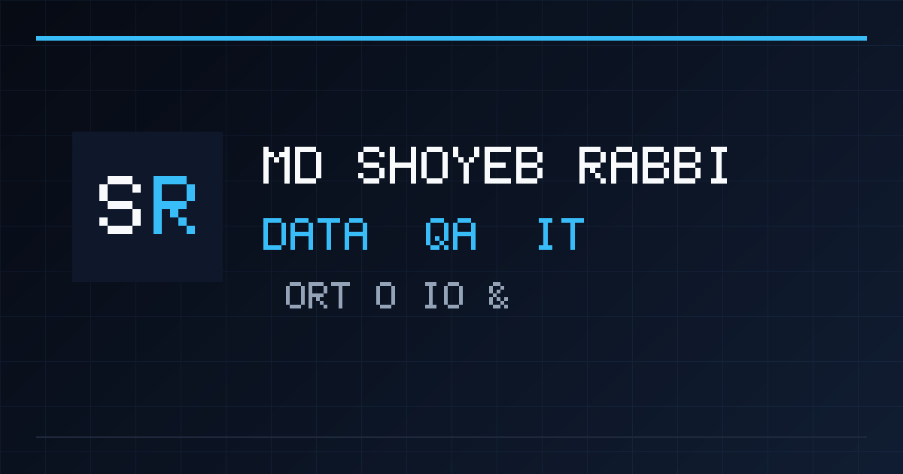

# 🌟 CV Master Studio & Executive Portfolio

<div align="center">



### **MD SHOYEB RABBI**
**Data Analyst · Software QA Engineer · Enterprise IT Operations Specialist**

[](https://react.dev/)
[](https://www.typescriptlang.org/)
[](https://vitejs.dev/)
[](https://tailwindcss.com/)
[](https://firebase.google.com/)
[](https://web.dev/progressive-web-apps/)
[](#-ats-audit-engine--1-click-optimization)
[](#-deployment-guide-github-pages)
[](LICENSE)

**[🌐 Live Portfolio & CV Studio](https://shoyebrabbi.com)** · **[📄 Live GitHub Pages](https://shoyebrabbi.github.io/cv-main/)** · **[💼 LinkedIn](https://linkedin.com/in/shoyebrabbi)** · **[🐙 GitHub](https://github.com/shoyebrabbi)**

</div>

---

## 📖 Table of Contents
- [✨ Key Highlights](#-key-highlights)
- [🏛️ Dual-Mode Architecture](#️-dual-mode-architecture)
- [🎨 16 Industry-Standard CV Templates](#-16-industry-standard-cv-templates)
- [💡 Zero-Code Studio Experience](#-zero-code-studio-experience)
  - [Action Bullet Points Library](#1--metric-driven-action-bullet-points-library)
  - [Pre-Built Section Templates](#2--pre-built-section-templates-library)
  - [Visual Drag-and-Drop Handles](#3--visual-drag-and-drop-reordering)
  - [CV Health & Pre-Flight Inspector](#4--cv-health--pre-flight-inspector)
  - [Free Header & Contact Movement](#5-️-free-header-movement--alignment-engine)
- [🎯 ATS Audit Engine & 1-Click Boost](#-ats-audit-engine--1-click-boost)
- [📦 Multi-Format Export Hub (10 Formats)](#-multi-format-export-hub-10-formats)
- [🔍 Recruiter Role-Lenses (?role=)](#-recruiter-role-lenses-role)
- [🔒 Enterprise Security Architecture](#-enterprise-security-architecture)
- [🛠️ Tech Stack & Libraries](#️-tech-stack--libraries)
- [📁 Project Structure](#-project-structure)
- [🚀 Local Development Setup](#-local-development-setup)
- [🌐 Deployment Guide (GitHub Pages & Vercel)](#-deployment-guide-github-pages--vercel)
- [⌨️ Keyboard Shortcuts](#️-keyboard-shortcuts)
- [👨‍💻 Author & Contact](#-author--contact)

---

## ✨ Key Highlights

**Unified CV Master Studio** is a state-of-the-art, client-first, ATS-optimized Master CV Builder, Interactive Portfolio, and Career CMS designed for modern engineers, analysts, and tech leaders.

- ⚡ **100% Offline & Client-First:** No heavy backend required. Runs with zero latency directly in modern web browsers.
- 🎯 **1-Click 100% ATS Boost:** Scans your CV against 6 ATS pillars and boosts your score to 100% with a single click.
- 🎨 **16 Distinct Design Templates:** From conservative corporate formats to high-impact split-column tech layouts and Wall Street single-column ATS templates.
- 🖐️ **Drag-and-Drop + Click-to-Add:** Easily drag sections or experiences and add pre-written metric bullets without touching code.
- 🩺 **Pre-Flight Inspector:** Scans for missing punctuation, broken URLs, overflow text, and dummy placeholders before export.
- 📲 **PWA & Offline-First:** Installable on desktop and mobile with automatic asset precaching via Service Worker.
- 🖨️ **Vector A4 PDF & 10 Export Formats:** Direct vector A4 print, Word `.docx`, 5-sheet Excel workbook, CSV, PNG, HTML, Markdown, and JSON backup.

---

## 🏛️ Dual-Mode Architecture

The platform operates in two seamless modes tailored for different audiences:

```
┌────────────────────────────────────────────────────────────────────────┐
│                   Unified CV Master Studio & Platform                  │
└──────────────────┬──────────────────────────────────┬──────────────────┘
                   │                                  │
                   ▼                                  ▼
      ┌─────────────────────────┐        ┌─────────────────────────┐
      │   Web Portfolio View    │        │     A4 CV Studio        │
      │  (Public / Recruiters)  │        │   (Owner / Author)      │
      ├─────────────────────────┤        ├─────────────────────────┤
      │ • Modern Dark Theme     │        │ • Live 2-Page A4 Canvas │
      │ • Role-Tailored Lenses  │        │ • Inline WYSIWYG Edit   │
      │ • Live Radar Pulse      │        │ • 16 Design Templates   │
      │ • Case Studies & Proof  │        │ • Pre-built Bullet Lib  │
      │ • Interactive Dashboards│        │ • Pre-built Section Lib │
      │ • Direct Recruiter Form │        │ • ATS 100% Optimizer    │
      └─────────────────────────┘        └─────────────────────────┘
```

1. **🌐 Web Portfolio View (`WebPortfolioView.tsx`):**
   A premium, high-conversion dark-mode portfolio highlighting technical competencies, case studies, interactive Power BI/video dashboard embeds, skill matrices with 5-dot proficiency ratings, verified credentials, and recruiter contact inquiry forms.
2. **📄 CV Master Studio (`CVDocument.tsx`):**
   A pixel-perfect, 2-page A4 canvas with live on-canvas WYSIWYG editing, floating toolbars, typography customization, section reordering, bullet insertion, and export controls.

---

## 🎨 16 Industry-Standard CV Templates

Select from 16 battle-tested templates designed to pass both automated Applicant Tracking Systems (ATS) and human recruiter reviews:

| # | Template Key | Style Name | Target Industry / Focus | Layout Mode |
|---|:---|:---|:---|:---:|
| 1 | `bd-corporate` | Bangladesh Corporate Classic | Enterprise Banking, Telecom, Multi-national Corporate | Top Bar Accent |
| 2 | `modern-split` | Modern Tech Split | Software Engineering, QA & Tech Startups | Split Accent |
| 3 | `executive-minimal` | Executive Minimalist | Tech Management, Team Leads & Product Management | Monochrome Clean |
| 4 | `tech-dark-accents` | High-Tech Dark Accent | Cloud, DevOps & Systems Engineering | Dark Accent Bar |
| 5 | `compact-ats` | Single-Page Compact ATS | 1-Page High-Density Technical Profiles | Single Column ATS |
| 6 | `two-col-sidebar` | Two-Column Sidebar | Comprehensive Profiles with high skill-to-experience ratios | Left Sidebar |
| 7 | `elegant-serif` | Elegant Serif Executive | Legal, Consulting, Senior Academic & Advisory | Classic Serif |
| 8 | `slate-formal` | Slate Formal Enterprise | Government, Defense & Formal Infrastructure | Slate Gray Accent |
| 9 | `emerald-accent` | Emerald Green Modern | FinTech, Sustainability & Environmental Tech | Emerald Bar |
| 10 | `crimson-bold` | Crimson Executive | Sales Engineering, Marketing & Creative Tech | Crimson Bold |
| 11 | `clean-mono` | Developer Clean Mono | Full-Stack, Backend Developers & Data Engineers | Monospace Touch |
| 12 | `minimal-wireframe` | Minimal Wireframe | UI/UX, Product Designers & Technical Architects | Subtle Bordered |
| 13 | `nordic-emerald` | Nordic Sage Emerald | FinTech, Data Science & Scandinavian Clean Aesthetics | 2-Column Split |
| 14 | `royal-indigo` | Royal Indigo Prestige | Fortune 500 Enterprise & Leadership Roles | Indigo Ribbon |
| 15 | `elite-crimson` | Elite Crimson Executive | Corporate Strategy, SQA Leadership & Operations | Executive Crimson |
| 16 | `wallstreet-ats` | Wall Street / FAANG Pure ATS | Pure ATS, FAANG, Quantitative Finance & Tier-1 Global ATS | Single Column Text |

---

## 💡 Zero-Code Studio Experience

Everything in the studio is designed so you never have to write code or tweak CSS manually:

### 1. 💡 Metric-Driven Action Bullet Points Library
Access a built-in library of quantifiable, high-impact bullet points across 4 core technical tracks:
- **Data Analyst & BI:** Multi-table SQL joins, Star Schema modeling, ETL pipelines, Power BI dashboard metrics.
- **Software QA Engineer:** BVA/ECP test design, Postman REST API assertions, regression cycles, Jira defect lifecycle.
- **IT Support & Network Admin:** Windows/Linux server management, LAN switches, ERP data auditing, Tier-2 support.
- **Technical Leadership:** Agile sprint planning, cross-functional mentoring, SLA delivery, zero-defect releases.
*Click any role's toolbar and insert instantly.*

### 2. ⚡ Pre-Built Section Templates Library
Add pre-formatted corporate sections with a single click:
- 🏆 **Awards & Honors** (Award title, issuing organization, year, impact description)
- 📚 **Publications & Research** (Paper title, journal/conference, DOI/URL, abstract)
- 🤝 **Volunteering & Leadership** (Role, organization, dates, community impact)
- 👥 **Professional References** (Sleek 2-column cards with name, title, organization, email, and phone)
- 🌐 **Language Proficiency** (CEFR Framework: C2 Native, C1 Fluent, B2 Professional)
- 🎯 **Key Achievements** (Metric-driven highlight badges)

### 3. 🖐️ Visual Drag-and-Drop Reordering
- Reorder any section on your CV by dragging its `GripVertical` handle up or down.
- Reorder individual work experience roles or project cards with smooth visual feedback.
- Dedicated up/down precision nudgers for fine control.

### 4. 🩺 CV Health & Pre-Flight Inspector
Before sending your CV or generating a PDF, click **CV Health** to automatically scan:
- Missing terminal punctuation (periods at the end of bullets)
- Dummy or placeholder text ("Lorem ipsum", "TODO", "John Doe")
- Broken or malformed URLs
- Page spill / vertical overflow beyond page boundaries
- **1-Click Auto Fix:** Automatically fixes missing punctuation and trims layout spacing.

### 5. 🎛️ Free Header Movement & Alignment Engine
- **Name & Title:** Independently align to the **Left**, **Center**, or **Right**.
- **Contact Details:** Independently align to the **Left**, **Center**, or **Right**.
- **Corporate Split Layout:** Name on the left, contacts neatly stacked on the right.
- **Custom Separators:** Choose between Dot (`·`), Pipe (`|`), Slash (`/`), Dash (`-`), or None.
- **Zero Ghost Spacing:** Hiding icons leaves zero awkward whitespace or misaligned text.

---

## 🎯 ATS Audit Engine & 1-Click Boost

Built according to modern Applicant Tracking System (ATS) parsing rules:

```
┌──────────────────────────────────────────────────────────────┐
│                    ATS Engine Dimensions                     │
├───────────────────────────────┬──────────────────────────────┤
│ 1. Contact & Identification   │ Email, Phone, Location, URLs │
│ 2. Standard Section Headings  │ Work, Skills, Education, etc.│
│ 3. Quantifiable Metrics       │ Numbers, %, $, +, Reductions │
│ 4. Keyword Match Density      │ SQL, QA, API, ERP, BI, Tools │
│ 5. Action Verb Verification   │ Engineered, Built, Audited   │
│ 6. ATS Layout Compliance      │ Clean headings, no textboxes │
└───────────────────────────────┴──────────────────────────────┘
```

- **Live Real-Time Scoring:** Visual progress ring tracking your composite ATS readiness.
- **Job Description (JD) Keyword Matcher:** Paste any job posting to calculate match percentage and missing keywords.
- **⚡ 1-Click 100% Boost:** Automatically replaces missing terms, injects industry metrics, and aligns headings with Fortune 500 ATS standards.

---

## 📦 Multi-Format Export Hub (10 Formats)

Export your CV into any required format with zero third-party subscriptions:

| Format | File Extension | Engine / Technology | Best Use Case |
|:---|:---:|:---|:---|
| **Direct A4 PDF** | `.pdf` | `html2pdf.js` with auto-pagination | Standard job applications & recruiter emails |
| **Vector Print PDF** | `.pdf` | Browser Native CSS `@media print` | Highest-resolution, crisp vector text printing |
| **Word Document** | `.docx` | Formatted Word XML tables | HR agencies requiring editable Word format |
| **Excel Workbook** | `.xlsx` | SheetJS (5 distinct structured sheets) | Technical skills audits & HR records |
| **CSV Data Export** | `.csv` | UTF-8 Structured CSV | Applicant Tracking Database imports |
| **High-Res PNG** | `.png` | HTML Canvas Render | Social sharing, LinkedIn profile posts |
| **Standalone HTML** | `.html` | Self-contained HTML with embedded styles | Offline interactive portfolio viewing |
| **Markdown** | `.md` | GitHub Flavored Markdown | GitHub profile README & tech portfolios |
| **Plain Text** | `.txt` | UTF-8 Clean Plaintext | Legacy raw ATS paste boxes |
| **JSON Backup** | `.json` | Full Schema JSON | 1-Click backup and cloud restore |

---

## 🔍 Recruiter Role-Lenses (`?role=`)

Share customized views with recruiters using dedicated query parameters:

- **Data Analytics & BI Focus:**  
  `https://shoyebrabbi.com/?role=data`  
  *Highlights: Advanced SQL, PostgreSQL, Power BI Star Schema, Power Query ETL.*
- **Software QA & API Testing Focus:**  
  `https://shoyebrabbi.com/?role=sqa`  
  *Highlights: Manual testing, Postman REST API assertions, Jira defect tracking, BVA/ECP.*
- **Enterprise IT & Network Operations:**  
  `https://shoyebrabbi.com/?role=netops`  
  *Highlights: Windows Server, Linux shell, MikroTik, ERP data sync, Tier-2 support.*
- **Master Executive (All-in-One):**  
  `https://shoyebrabbi.com/?role=master`  
  *Comprehensive multi-disciplinary hybrid profile.*

---

## 🔒 Enterprise Security Architecture

- **Strict Identity Separation:**
  - **Owner Admin Login:** `abc@gmail.com` (Secured gateway for cloud saving and profile publishing).
  - **Public CV & Recruiter Contact:** `shoyebrabbi@gmail.com` (Displayed publicly for inquiries and communication).
- **Firestore Security Rules:** Zero-trust architecture with verified UID and admin email checks preventing unauthorized writes.
- **Zero Secrets Leakage:** No private API keys or server credentials stored in client code.

---

## 🛠️ Tech Stack & Libraries

- **Core Framework:** [React 19](https://react.dev/) + [TypeScript 5.8](https://www.typescriptlang.org/)
- **Build Tool:** [Vite 8](https://vitejs.dev/) with Rollup/Rolldown minification
- **Styling:** [Tailwind CSS v4](https://tailwindcss.com/) with native OKLCH colors
- **Icons:** [Lucide React](https://lucide.dev/)
- **Data & Exporters:**
  - [SheetJS (`xlsx`)](https://sheetjs.com/) for multi-sheet Excel generation
  - `html2pdf.js` for client-side PDF compilation
  - `canvas-confetti` for celebratory milestones
  - `qrcode` for digital verification QR generation
- **Storage & Auth:** [Firebase v13](https://firebase.google.com/) (Auth, Firestore) + LocalStorage
- **PWA Engine:** `vite-plugin-pwa` with Workbox Service Worker caching

---

## 📁 Project Structure

```text
cv-main/
├── .github/
│   └── workflows/
│       └── deploy.yml            # Automated GitHub Actions deployment pipeline
├── public/
│   ├── .nojekyll                 # Bypasses Jekyll for fast GitHub Pages delivery
│   ├── 404.html                  # Single Page App redirector for subpaths & parameters
│   ├── icon.svg                  # Vector brand icon
│   ├── og-card.png               # High-res Open Graph social share card
│   ├── robots.txt                # Search engine crawler policies
│   └── sitemap.xml               # SEO sitemap
├── src/
│   ├── components/
│   │   ├── CVDocument.tsx        # 2-Page A4 Master CV Canvas (16 templates & toolbars)
│   │   ├── WebPortfolioView.tsx  # Interactive Executive Dark Portfolio View
│   │   ├── Navbar.tsx            # Responsive 2-tier control bar
│   │   ├── StyleCombinerDrawer.tsx # Left Theme, Layout & Typography Inspector
│   │   ├── StudioRightRail.tsx   # Right quick-action bar & jump navigation
│   │   ├── MobileCVEditor.tsx    # Touch-optimized mobile & tablet drawer
│   │   ├── Modals.tsx            # ATS Audit, Hyperlink, Bullet Library, Sections
│   │   ├── ExportHubModal.tsx    # Multi-format export dialog (10 formats)
│   │   └── OwnerLoginModal.tsx   # Verified owner authentication portal
│   ├── data/
│   │   ├── initialCV.ts          # Master CV profiles & default settings
│   │   ├── bulletLibrary.ts      # Curated metric bullet library
│   │   └── sectionTemplates.ts   # Curated pre-built section templates
│   ├── types/
│   │   └── cv.ts                 # Full TypeScript definitions & schema interfaces
│   ├── utils/
│   │   ├── exporters.ts          # PDF, Word, Excel, CSV, PNG, HTML export functions
│   │   ├── atsEngine.ts          # ATS 6-pillar analysis & scoring logic
│   │   └── imageCompress.ts      # Client-side avatar compression utility
│   ├── App.tsx                   # Main state coordinator & router
│   ├── firebase.ts               # Firebase initialization & cloud sync
│   ├── index.css                 # A4 page styles & print media stylesheets
│   └── main.tsx                  # React entry point & PWA register
├── project-notes/                # Full documentation, audit logs & change history
├── firestore.rules               # Enterprise Firestore security rules
├── package.json                  # Dependencies & build scripts
├── tsconfig.json                 # Strict TypeScript configuration
└── vite.config.ts                # Vite config (base: './', PWA, Tailwind)
```

---

## 🚀 Local Development Setup

### Prerequisites
- Node.js version `20.x` or `22.x`
- npm (comes with Node.js)

### Installation & Run

```bash
# 1. Clone this repository
git clone https://github.com/shoyebrabbi/cv-main.git

# 2. Navigate to project directory
cd cv-main

# 3. Install dependencies
npm install

# 4. Start development server
npm run dev
```

Open your browser at `http://localhost:3000` to view the live studio.

### Quality Checks & Build
```bash
# Type check without emitting files (0 errors)
npm run lint

# Production build (outputs to dist/)
npm run build

# Preview production build locally
npm run preview
```

---

## 🌐 Deployment Guide (GitHub Pages & Vercel)

### Option A: GitHub Pages (Automated via GitHub Actions)

This repository includes a pre-configured GitHub Actions workflow (`.github/workflows/deploy.yml`), `public/.nojekyll`, and `public/404.html`.

1. **Push your code to GitHub:**
   ```bash
   git init
   git add .
   git commit -m "feat: complete master CV studio and portfolio ready for production"
   git branch -M main
   git remote add origin https://github.com/<YOUR_USERNAME>/<YOUR_REPOSITORY_NAME>.git
   git push -u origin main
   ```

2. **Enable GitHub Pages:**
   - Go to your repository on GitHub.
   - Navigate to **Settings** > **Pages**.
   - Under **Build and deployment** > **Source**, select **GitHub Actions**.
   - Your site will automatically build and go live within 60–90 seconds at:  
     `https://<YOUR_USERNAME>.github.io/<YOUR_REPOSITORY_NAME>/`

### Option B: Vercel / Netlify
- Import your GitHub repository into Vercel or Netlify.
- Framework Preset: **Vite**
- Build Command: `npm run build`
- Output Directory: `dist`
- Click **Deploy** — everything works out of the box with zero additional configuration.

---

## ⌨️ Keyboard Shortcuts

Speed up your workflow using built-in keyboard shortcuts:

| Shortcut | Action |
|:---|:---|
| <kbd>Ctrl</kbd> / <kbd>Cmd</kbd> + <kbd>P</kbd> | Open High-Precision Vector Print / PDF Dialog |
| <kbd>Ctrl</kbd> / <kbd>Cmd</kbd> + <kbd>S</kbd> | Quick Save to Cloud / Local Storage |
| <kbd>Ctrl</kbd> / <kbd>Cmd</kbd> + <kbd>E</kbd> | Toggle between Edit Mode and Clean Preview |
| <kbd>Ctrl</kbd> / <kbd>Cmd</kbd> + <kbd>Z</kbd> | Undo Last Action |
| <kbd>Ctrl</kbd> / <kbd>Cmd</kbd> + <kbd>Y</kbd> | Redo Last Action |
| <kbd>Ctrl</kbd> / <kbd>Cmd</kbd> + <kbd>B</kbd> | Bold Selected Text |
| <kbd>Ctrl</kbd> / <kbd>Cmd</kbd> + <kbd>I</kbd> | Italicize Selected Text |
| <kbd>Ctrl</kbd> / <kbd>Cmd</kbd> + <kbd>U</kbd> | Underline Selected Text |
| <kbd>Esc</kbd> | Close Any Open Modal or Drawer |

---

## 👨‍💻 Author & Contact

**MD SHOYEB RABBI**  
*Computer Science & IT Graduate (B.Sc. in CSIT)*  
Chattogram, Bangladesh

- 🌐 **Portfolio:** [https://shoyebrabbi.com](https://shoyebrabbi.com)
- 💼 **LinkedIn:** [linkedin.com/in/shoyebrabbi](https://linkedin.com/in/shoyebrabbi)
- 🐙 **GitHub:** [github.com/shoyebrabbi](https://github.com/shoyebrabbi)
- ✉️ **Email:** [shoyebrabbi@gmail.com](mailto:shoyebrabbi@gmail.com)
- 📱 **Phone / WhatsApp:** [shoyebrabbi](https://wa.me/shoyebrabbi)

---

<div align="center">

*Designed & Engineered with ❤️ for ambitious engineers and modern professionals.*  
**Distributed under the MIT License.**

</div>
